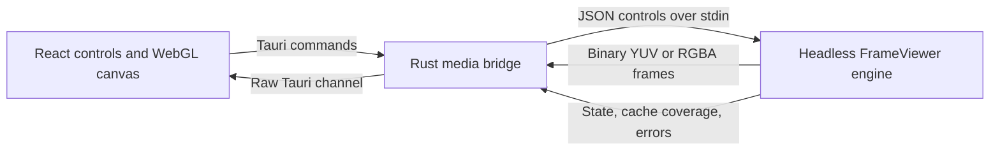

# Current player architecture

The original Electron board UI is migrated to React in Tauri. Rust owns filesystem access, board settings, sidecars, native pickers, thumbnail jobs and the media backend lifetime. Electron, Node filesystem access, electron-store and the localfile protocol are not shipped.

## Player data flow

1. React opens the media overlay, registers its state listener and binary channel, and asks Rust to open the selected file.
2. Rust checks the canonical file path against the selected/imported folders. It launches or reuses `media/MoodframeMedia.exe` with no GUI/console window and no media/session command-line arguments.
3. The backend runs QCoreApplication, the adapted playback controller and the original MediaWorker/Decoder/FrameRepository/PrefetchPlanner/AudioEngine. It does not construct a QGuiApplication, QML engine, Qt Quick renderer or parented video window.
4. Frames keep FrameViewer's compact YUV420 planes and color transform where possible. Unusual pixel formats use RGBA. A versioned binary stream carries metadata plus pixel bytes to Rust.
5. Rust forwards raw bytes through `Channel<InvokeResponseBody>`; React receives an ArrayBuffer. WebGL2 uploads the planes and applies the original color matrix. A bounded recent-texture cache avoids repeat uploads of cached frames. Canvas2D is a slower fallback if WebGL2 is unavailable.
6. DOM controls send play, pause, stepping, preview, release/commit, volume and loop commands. Fullscreen belongs to the Tauri window. React keeps draft scrub targets responsive while the native worker returns decoded frames.
7. The renderer acknowledges each delivered frame. Until then the backend sends no additional frame and retains only the latest pending result. Control/state messages remain separate from pixel bytes.
8. On close, React releases browser textures and Rust clears the active session and unloads the clip. The empty backend is reused for 30 seconds before idle exit. Broken control pipes terminate it after the app exits. Session IDs reject stale frames, commands and events.

## What caused the previous error

The previous child-window implementation passed `--session` to QGuiApplication. Qt consumed it as its own session-restore option, leaving the native readiness message with an empty session ID. Rust then timed out waiting for the expected ID. The old native tests omitted that production argument.

That entire Qt window/embedding path is now removed. Session IDs are JSON protocol data, not Qt CLI options. A new regression test covers the real production Rust process launch and raw channel, and deployment tests run the backend with a clean PATH against only bundled libraries. Startup errors capture stderr, exit status and a local log path.

## Backend dependencies

Qt Core provides events/timers/data, Qt Gui provides QImage/QMatrix4x4, and Qt Multimedia provides audio. They remain private dependencies of the reused C++ media engine. The UI and renderer use Tauri/React/WebGL and do not load Qt Quick or QML. This is a backend reuse, not a port of the whole media engine to Rust.

## Persistence and scope

The board UI, image lightbox, drag ordering, nested/linked groups, covers, themes and per-folder layouts are retained. Existing Electron configuration is copied once, while `.moodboard.json` sidecars are preserved in place. Config and sidecar mutations are serialized and atomic. Canonical paths and Tauri asset protocol grants constrain media access to imported/selected folders or approved files. The WebView has no arbitrary filesystem or shell plugin permission.

Group deletion is nonrecursive and refuses unknown files/nested directories. The thumbnail cache is separate from video decoded-frame caching. Four thumbnail workers and viewport-based loading limit background work.
